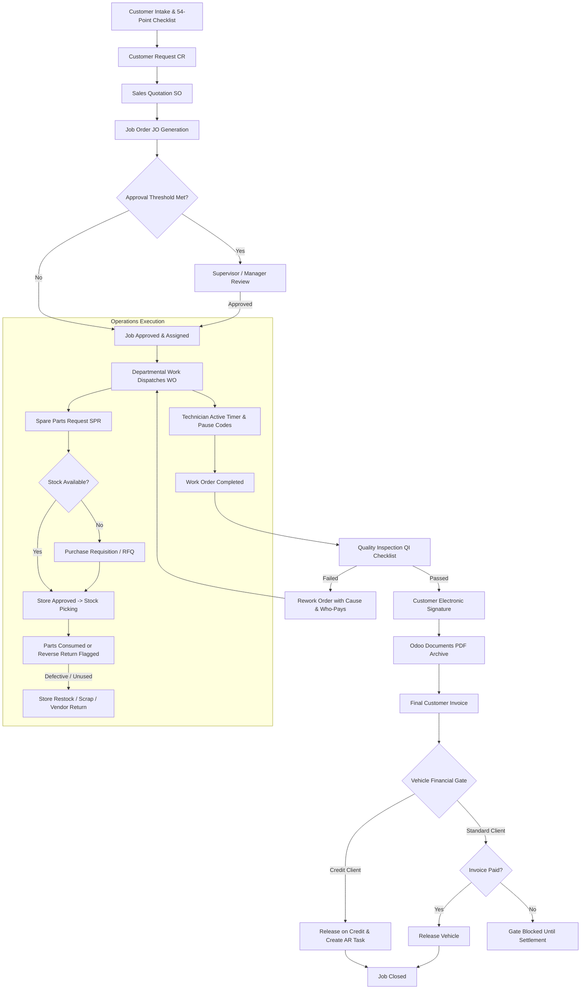

# Workshop Management System for Odoo 19

[](https://www.odoo.com)
[](https://www.gnu.org/licenses/lgpl-3.0.html)
[](#)
[](https://www.toptechnologies.com)

An end-to-end industrial and automotive workshop management platform built natively for **Odoo 19**. Originally architected for heavy-duty vehicle and equipment operations (e.g., Tana Engineering PLC), this module digitalizes the complete operational lifecycle from customer reception to quotation, multi-tier approvals, departmental work dispatching, technician real-time timer tracking, inventory pickings, automated purchase requisitions, reverse logistics, field service operations, quality assurance gating, financial release control, and executive profitability analytics.

---

## Table of Contents

- [Key Highlights](#key-highlights)
- [System Architecture & Lifecycle Flow](#system-architecture--lifecycle-flow)
- [Core Functional Modules](#core-functional-modules)
  - [1. Equipment & Vehicle Reception Master](#1-equipment--vehicle-reception-master)
  - [2. Customer Requests & Quotation Estimation](#2-customer-requests--quotation-estimation)
  - [3. Multi-Tier Approval Rule Engine](#3-multi-tier-approval-rule-engine)
  - [4. Job Orders & Departmental Work Dispatches](#4-job-orders--departmental-work-dispatches)
  - [5. Technician Timer & Clock-In/Out Tracking](#5-technician-timer--clock-inout-tracking)
  - [6. Spare Parts Requisition, Shortages & Reverse Logistics](#6-spare-parts-requisition-shortages--reverse-logistics)
  - [7. Field Service Management & Field Expenses](#7-field-service-management--field-expenses)
  - [8. Quality Inspections & Customer Acceptance](#8-quality-inspections--customer-acceptance)
  - [9. Two-Way Vehicle Release Financial Gate](#9-two-way-vehicle-release-financial-gate)
  - [10. Service Agreements & Targeted Warranties](#10-service-agreements--targeted-warranties)
  - [11. Automotive KPI Dashboards & Profitability Analytics](#11-automotive-kpi-dashboards--profitability-analytics)
  - [12. Odoo Enterprise Documents Integration](#12-odoo-enterprise-documents-integration)
- [User Roles & Security Privileges](#user-roles--security-privileges)
- [Sequence Numbering Scheme](#sequence-numbering-scheme)
- [Dependencies & Installation](#dependencies--installation)
- [Configuration Guide](#configuration-guide)
- [Copyright & Licensing](#copyright--licensing)

---

## Key Highlights

- **Standard vs. Actual Labor Costing**: Automatically separates billing/costing based on standard hours (`workshop.task.master`) from raw clock timer hours to prevent penalizing customers or distorting labor profitability.
- **Reverse Logistics for Parts**: Return flagging directly from the shop floor with 3 distinct storekeeper dispositions: Restock to inventory, Scrap with loss tracking, or Return to Vendor with automated replacement requests.
- **Two-Way Financial Release Gate**: Protects cash flow by blocking standard walk-in clients until their invoice is fully settled, while allowing corporate credit clients to collect equipment immediately with automated accounts receivable (AR) payment tracking activities.
- **Departmental Routing**: Manages handoffs across Mechanical, Body/Panel, Electrical, Painting, and Inspection divisions.
- **Field Service Out-of-Pocket Expenses**: Technicians log fuel, lodging, and transport expenses from the field; supervisors validate with receipts, and approved amounts are marked up and billed onto the sales invoice automatically.
- **Targeted Warranty Rules**: Automated warranty issuance specifically for major component overhauls (Engine Overhaul and Gearbox) with durations dynamically determined by vehicle type, customer agreement, and contract terms.
- **Interactive OWL Dashboards**: Features real-time workshop control dashboards and executive automotive KPI metrics (Turnaround Time, First-Time Fix Rate, Technician Utilization, Profit Margins).

---

## System Architecture & Lifecycle Flow



---

## Core Functional Modules

### 1. Equipment & Vehicle Reception Master
- **Comprehensive Equipment Registry**: Tracks vehicles, heavy machinery, generators, and equipment linked to customers with VIN/chassis number, license plate, make, model, and engine specifications.
- **54-Point Intake Checklist**: Standard vehicle condition assessment covering exterior glass, mirrors, engine fluid dipsticks, lighting, spare tire, dashboard gauges, battery condition, and tools.
- **Condition Ratings**: Standardized grading for each item (`Good`, `Fair`, `Damaged`, `Missing`, `N/A`) with inspection remarks and photo attachments.
- **Standard Intake Terms**: Built-in legal terms regarding personal property, custody limits, and demurrage/parking fees (e.g., parking fees applied after 14 days post-completion).

### 2. Customer Requests & Quotation Estimation
- **Entry Gate**: Allows receptionists and service advisors to log customer complaints, initial inspection notes, and photographs before committing resources.
- **Quotation Estimation Lines**: Builds preliminary labor, parts, sublet services, and field service charges (mileage, travel time, per diem, fuel).
- **Service Agreement Awareness**: Detects running customer service agreements and flags covered vs. billable lines prior to quotation creation.
- **Sales Order Generation**: Automatically generates and links an Odoo Quotation (`sale.order`) directly from the request lines.

### 3. Multi-Tier Approval Rule Engine
- **Configurable Value Thresholds**: Create approval rules triggered when estimated job order values exceed defined monetary limits.
- **Native Odoo Approvals Integration**: Seamlessly dispatches approval requests to Odoo’s `approvals` application.
- **Dual Approval Levels**:
  - *Supervisor Review*: Standard operational review for moderate job estimates.
  - *Manager Review*: Mandatory second-tier review for major repairs and high-value orders.
- **Audit Logging**: Comprehensive approval log recording the approver, timestamp, action, and rationale.

### 4. Job Orders & Departmental Work Dispatches
- **Job Order (`workshop.job.order`)**: The central operational orchestrator maintaining full visibility over parts, labor, progress, deadlines, sublet costs, and invoicing.
- **Departmental Work Dispatches (`workshop.work.order`)**: Dispatches work items to dedicated departments:
  - **Mechanical**: Engine, transmission, braking, and suspension systems.
  - **Body / Panel**: Structural repairs, dent removal, chassis alignment.
  - **Electrical**: Diagnostics, wiring harnesses, alternators, ECU programming.
  - **Painting**: Surface preparation, spray booth painting, detailing.
  - **Inspection**: Incoming/outgoing testing, road tests, diagnostic scans.
- **Rework Tracking**: When tasks fail quality or customer acceptance, work orders transition to `rework` status. Captures:
  - *Rework Cause*: Quality inspection failure, customer complaint, incomplete work, parts defect.
  - *Liability (Who Pays)*: Workshop, Customer, Warranty, or Technician.

### 5. Technician Timer & Clock-In/Out Tracking
- **Interactive Timer UI**: Technicians start, pause, resume, and stop timers directly on their assigned Work Dispatches.
- **Standardized Pause Codes**: Mandates clock-out reason codes to eliminate untracked downtime:
  - `0`: Work Completed
  - `1`: Lunch Break
  - `2`: Tea Break
  - `3`: End of Day
  - `5`: Spare Part Out of Stock
  - `6`: Sick
  - `7`: Waiting for Approval
  - `8`: Sublet
  - `9`: Meeting
  - `10`: Assisting Another Job
  - `11`: Fuel and Lubricant Supply
  - `12`: Specific Work Completed
  - `14`: Send to Machine Shop
- **Analytic Line Generation**: Timer sessions automatically aggregate into standard Odoo timesheets (`account.analytic.line`) linked to the job's analytic account.

### 6. Spare Parts Requisition, Shortages & Reverse Logistics
- **Requisition Workflow**: Technicians submit part requirements against specific work orders with requested quantities.
- **Store Approval & Stock Picking**: Storekeepers review and approve requests, automatically generating internal transfers or delivery pickings (`stock.picking`).
- **Shortage Auto-Procurement**: If warehouse inventory is insufficient, the system flags shortages and can automatically generate a Purchase Requisition / RFQ (`purchase.order`).
- **Reverse Logistics Engine**:
  - *Shop Floor Flagging*: Technicians flag issued parts that are `Unused / Leftover`, `Wrong Fit`, or `Defective`.
  - *Disposition Actions*: Storekeepers execute returns to stock (`Restock`), scrap damaged components (`Scrap`), or return them to suppliers (`Vendor Return`).
  - *Replacement Requisitions*: One-click option to create a replacement spare request linked to the original return.

### 7. Field Service Management & Field Expenses
- **In-Shop vs. Field Service**: Toggle jobs between internal workshop execution and field service interventions.
- **Geographic Dispatching**: Records site contacts, physical addresses, and GPS coordinates (Latitude/Longitude) with map integration.
- **Field Visits (`workshop.field.visit`)**: Tracks site travel, technician check-in, check-out, on-site hours, and visit reports.
- **Field Technician Expenses (`workshop.expense`)**:
  - Technicians record out-of-pocket expenses (fuel, lodging, tolls, local spare purchases) with attached receipts.
  - **Foreman Validation**: Field supervisors must review and validate expenses prior to processing.
  - **Cost Plus Margin**: Calculates company markup (e.g., 20% margin) and creates billable service lines on the linked Sales Order.

### 8. Quality Inspections & Customer Acceptance
- **Configurable Checklist Templates**: Pre-configured quality inspection checklists per department and vehicle type.
- **Mandatory Gating**: A Job Order cannot transition to `Completed` until all associated Work Dispatches pass Quality Inspection.
- **Electronic Customer Acceptance**:
  - On-screen touch signature capture directly on the tablet or desktop.
  - Generates a certified **Workshop Completion Report (PDF)**.
- **Automatic Document Filing**: Automatically files completion certificates and inspection photos into Odoo Documents folders categorized by customer and equipment.

### 9. Two-Way Vehicle Release Financial Gate
Protects the workshop from uncollectible receivables while providing flexibility for trusted enterprise fleet accounts:
- **Standard / Walk-In Customers**: The system verifies customer invoice status. The vehicle handover button remains hard-blocked until the linked customer invoice is registered as **Paid** in full.
- **Credit / Corporate Fleet Customers**: Recognized credit partners (`res.partner.workshop_client_class == 'credit'`) can receive their equipment immediately upon job completion. The system:
  - Logs the release mode as `credit`.
  - Records the releasing user and timestamp.
  - Automatically schedules a high-priority Odoo Activity assigned to the collections team to track pending settlement.

### 10. Service Agreements & Targeted Warranties
- **Service Contracts (`workshop.agreement`)**:
  - Tracks contract terms, coverage dates, prepaid labor hours, and remaining scheduled visits.
  - Automatically identifies covered vs. billable items during quotation and work execution.
- **Major Service Warranties (`workshop.warranty`)**:
  - Specialized warranty policies strictly scoped for high-value overhauls: **Engine Overhaul** and **Gearbox**.
  - Dynamic duration calculations based on vehicle type, customer class, and contractual warranty rules.
  - Validates warranty validity during intake to ensure covered warranty claims bypass customer quotation billing.

### 11. Automotive KPI Dashboards & Profitability Analytics
- **Executive Operations Dashboard**:
  - Real-time counts of active jobs, pending approvals, vehicles on shop floor, and jobs waiting on parts.
  - Technician workload visualization and departmental throughput.
- **Automotive KPI Framework**:
  - **Turnaround Time (TAT)**: Average lead time from intake reception to vehicle release.
  - **First-Time Fix Rate (FTFR)**: Ratio of jobs completed without subsequent rework or warranty callbacks.
  - **Technician Utilization**: Ratio of billable standard hours produced versus total clocked/available hours.
  - **Rework Rate**: Percentage of work orders requiring rework, categorized by cause and liability.
- **Job Costing & Profitability Rollup**:
  - Side-by-side comparison of **Expected Revenue vs. Actual Cost** across Labor, Parts, Sublet, and Field Expenses.
  - Profit breakdown based on both posted customer invoices and real-time operational consumption.

### 12. Odoo Enterprise Documents Integration
- Automatically maintains organized folder hierarchies in the Odoo `documents` app:
  - `Workshop / Equipment History`: Intake photos, registration cards, chassis plate images.
  - `Workshop / Completed Jobs`: Signed completion certificates and delivery acknowledgments.
  - `Workshop / Quality & Inspections`: Pre-work diagnostic reports and signed QC inspection sheets.

---

## User Roles & Security Privileges

Built using Odoo 19's `res.groups.privilege` framework:

| Security Role | Group Identifier | Typical User | Key Permissions |
|---|---|---|---|
| **Receptionist** | `group_workshop_receptionist` | Front Desk / Service Advisor | Register equipment, fill 54-point intake checklist, log Customer Requests. Cannot assign work orders or issue warehouse parts. |
| **Technician** | `group_workshop_technician` | Shop Floor Mechanics, Electricians | View assigned work dispatches, operate timer, request spare parts, flag part returns, log field expenses. |
| **Supervisor** | `group_workshop_supervisor` | Workshop Foreman, Lead Engineer | All technician rights plus: view all departmental dispatches, assign technicians, approve Level-1 Job Orders, validate field expenses, execute vehicle release. |
| **Store User** | `group_workshop_store` | Storekeeper, Parts Manager | Review and approve spare part requests, validate stock pickings, manage shortage procurement, inspect part returns (restock/scrap/vendor return). |
| **Manager** | `group_workshop_manager` | Workshop Director, General Manager | Full access: second-tier approval overrides, labor rate matrix rules, financial release rules, KPI dashboards, and system settings. |

---

## Sequence Numbering Scheme

The module provides standard sequences across all documents:

| Document | Model | Prefix Pattern | Example |
|---|---|---|---|
| **Customer Request** | `workshop.request` | `CR-#####` | `CR-00104` |
| **Workshop Job Order** | `workshop.job.order` | `JO-#####` | `JO-00042` |
| **Work Dispatch** | `workshop.work.order` | `WO-#####` | `WO-00089` |
| **Spare Parts Request** | `workshop.spare.request` | `SPR-#####` | `SPR-00031` |
| **Quality Inspection** | `workshop.quality.inspection` | `QI-#####` | `QI-00015` |
| **Field Visit** | `workshop.field.visit` | `FV-#####` | `FV-00008` |
| **Service Warranty** | `workshop.warranty` | `WAR-#####` | `WAR-00003` |
| **Field Expense** | `workshop.expense` | `EXP-#####` | `EXP-00012` |

---

## Dependencies & Installation

### Module Dependencies
- **Core Odoo Modules**:
  - `sale` / `sale_management` (Quotations & invoicing integration)
  - `stock` (Spare parts issues & warehouse returns)
  - `purchase` (Automated shortage RFQs)
  - `account` (Analytic accounting & customer invoicing)
  - `hr` / `hr_timesheet` (Employee rates & timesheet analytics)
  - `base_geolocalize` (Field service GPS coordinates)
  - `mail` (Chatter, activities, and notifications)
- **Enterprise Features**:
  - `documents` (Automated document archiving)
  - `approvals` (Multi-tiered approval workflows)

### Installation Steps
1. Place the `workshop_management` directory into your custom addons path:
   ```bash
   cp -r workshop_management /path/to/odoo/custom_addons/
   ```
2. Update your Odoo App List:
   - Navigate to **Apps** in developer mode.
   - Click **Update App List**.
3. Locate **Workshop Management** and click **Install**.
4. The `post_init_hook` will automatically:
   - Configure required Documents workspace folders for your companies.
   - Establish secure record rules for technician work orders.

---

## Configuration Guide

1. **Company Workshop Settings**:
   - Navigate to **Workshop > Configuration > Settings**.
   - Enable or configure the **Two-Way Financial Release Gate**.
   - Set up default Documents workspaces for workshop archiving.
2. **Approval Threshold Rules**:
   - Go to **Workshop > Configuration > Approval Rules**.
   - Define amount thresholds (e.g., orders above 50,000 ETB require Manager approval).
3. **Labor Rate Matrix**:
   - Go to **Workshop > Configuration > Labor Rate Rules**.
   - Assign hourly labor rates by **Customer Type** (e.g., Fleet, Corporate, Government, Walk-in) and pricelist rules.
4. **Targeted Warranty Rules**:
   - Go to **Workshop > Configuration > Warranty Period Rules**.
   - Set standard warranty durations for Engine Overhaul and Gearbox repairs by vehicle category.
5. **Quality Inspection Checklists**:
   - Go to **Workshop > Configuration > QI Checklist Templates**.
   - Tailor pass/fail quality criteria for Mechanical, Body, Electrical, and Road Testing.

---

## Copyright & Licensing

- **Author**: Top Technologies System Solutions PLC
- **Website**: [https://www.toptechnologies.com](https://www.toptechnologies.com)
- **License**: GNU Lesser General Public License v3.0 (LGPL-3)
- **Copyright**: © 2024–Present Top Technologies System Solutions PLC. All rights reserved.
